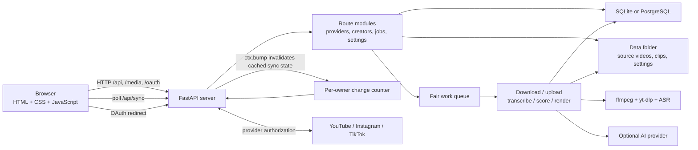
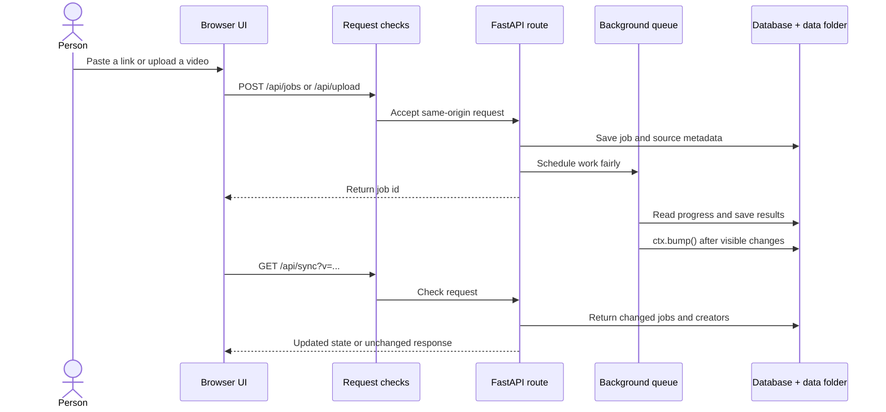

# Architecture and request flow

RONB Clips is a single FastAPI process with a plain HTML/CSS/JavaScript frontend. The server and background workers share a database and a data folder. A laptop can use SQLite; a hosted deployment uses PostgreSQL and the same data-folder layout for media.

## Main parts

## Request flow

The browser sends API requests to the same origin. The server checks the host, origin and request limits before a route runs. In this local-owner build there is no sign-in: all application data belongs to the built-in owner. OAuth is only for connecting a posting destination.

## Code map

- `studio/server.py` assembles the app, applies request checks and starts workers.
- `studio/*_api.py`, `studio/providers.py`, and `studio/settings.py` define HTTP routes and request models.
- `studio/jobs.py`, `studio/transcribe.py`, `studio/brain.py`, and `studio/render.py` run the clipping pipeline.
- `studio/db.py` and `studio/migrations.py` define storage and schema changes.
- `web/index.html` and `web/assets/` are the no-build frontend.
- `data/` is runtime state and is not source code.

## API schema

The running app serves the interactive API reference at [`/api/docs`](http://127.0.0.1:8765/api/docs) and its OpenAPI JSON at [`/api/openapi.json`](http://127.0.0.1:8765/api/openapi.json). See [API reference](api.md) for access rules and route groups.
